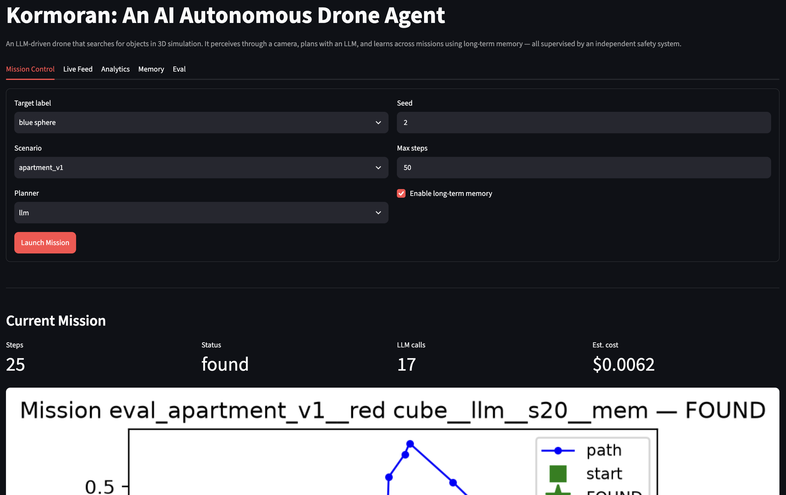
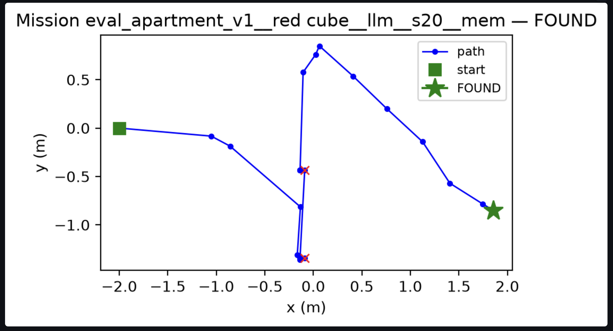
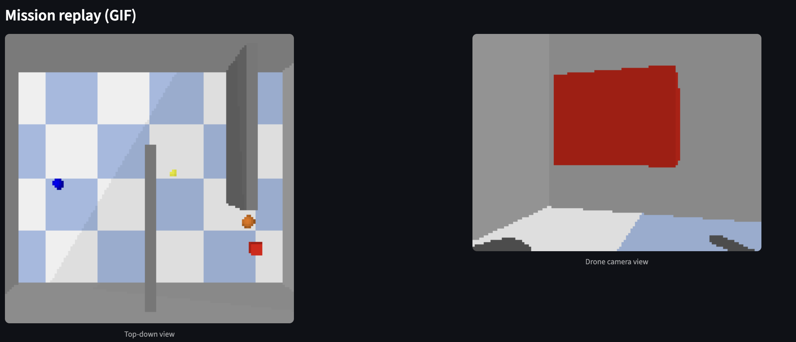
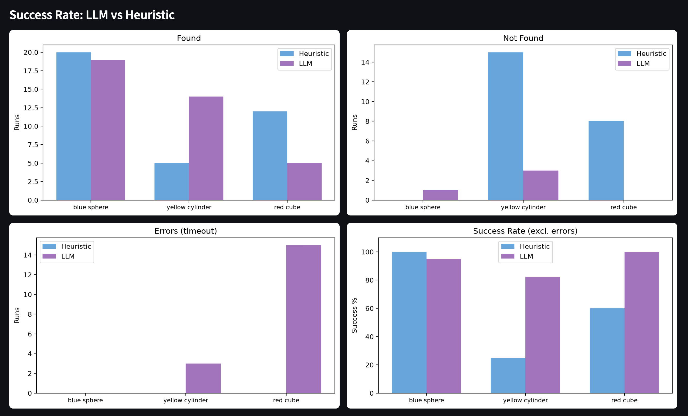
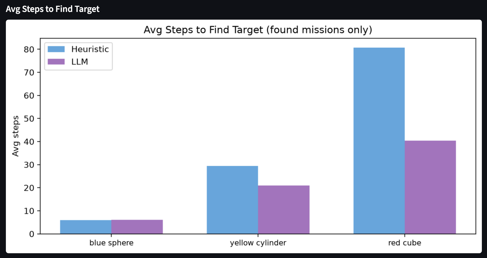
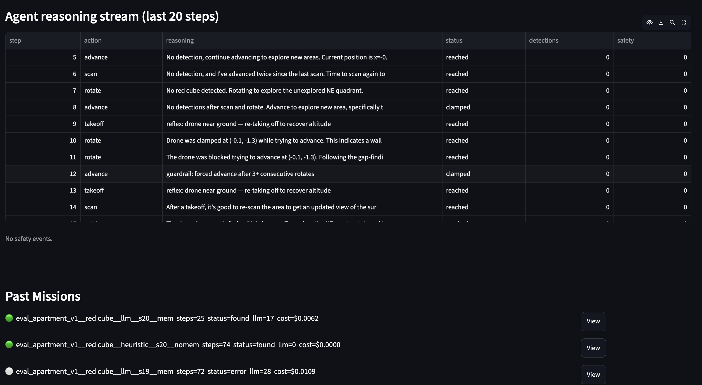

# Kormoran: An AI Autonomous Drone Agent

An LLM-driven drone that searches for objects in 3D simulation. It perceives through a camera, plans with an LLM, and learns across missions using long-term memory — all supervised by an independent safety system.

[Showcase](https://showcase.turingcollege.com/project/7572ea89-22ec-4343-abe4-0f191e454d95)



**Problem it solves:** Traditional drone scripts break the moment the environment changes. A human-controlled drone requires constant attention. Kormoran bridges both: it uses an LLM to make high-level navigation decisions from camera observations, while a deterministic inner loop safely executes each move — so the same code works across different room layouts and target objects.

**How it works:** A LangGraph loop — *recall → perceive → plan → validate → act → check* — lets the model pick the next macro-action (scan, advance, climb, approach…) from what the camera currently shows. A deterministic PID controller flies each action inside gym-pybullet-drones. An independent safety supervisor vetoes any action that would violate geofence, altitude, or battery limits. Long-term memory (SQLite + ChromaDB) lets the agent recall where objects were found across missions, so search gets faster over time.




| | |
|---|---|
|  |  |



## Quick Run (5 minutes)

```bash
git clone https://github.com/TuringCollegeSubmissions/jramir-AE.CAP.AFA.1.1.git && cd jramir-AE.CAP.AFA.1.1
uv sync
cp .env.example .env
# Edit .env: OPENROUTER_API_KEY=sk-or-...

# Run a mission — watch the drone find the red cube
uv run kormoran run-mission --scenario living_room_v1 --target "red cube" --planner llm --seed 1

# Launch the dashboard
uv run kormoran dashboard
```

Need `uv`? Install it first: `curl -LsSf https://astral.sh/uv/install.sh | sh`

## Full Setup

```bash
# 1. Install uv if you don't have it
curl -LsSf https://astral.sh/uv/install.sh | sh

# 2. Clone and set up
git clone https://github.com/TuringCollegeSubmissions/jramir-AE.CAP.AFA.1.1.git && cd jramir-AE.CAP.AFA.1.1
uv sync
uv run pre-commit install

# 3. Copy env template and add your OpenRouter key
cp .env.example .env
# Edit .env: OPENROUTER_API_KEY=sk-or-...
# Edit .env: LLM_MODEL=google/gemini-2.5-flash  (recommended)

# 4. Verify the LLM connection
uv run kormoran check-llm

# 5. Run tests
uv run pytest -m "not llm"
```

## Running Missions

### Single mission

```bash
uv run kormoran run-mission \
  --scenario apartment_v1 \
  --target "yellow cylinder" \
  --planner llm \
  --max-steps 50 \
  --seed 2
```

### Multi-run learning test (recommended)

The agent learns across missions — walls, gaps, and target locations are stored in memory and reused. Run multiple missions to see the learning loop in action:

```bash
# Yellow cylinder (1-wall problem, 50 steps is enough)
uv run kormoran memory clear --yes
for i in 1 2 3 4 5 6; do
  echo "== YC $i =="
  uv run kormoran run-mission --scenario apartment_v1 \
    --target "yellow cylinder" --planner llm --max-steps 50 --seed 2
done 2>&1 | grep -E "== YC|Mission complete|Status"

# Red cube (2-wall problem, needs 100 steps)
for i in 1 2 3; do
  echo "== RC $i =="
  uv run kormoran run-mission --scenario apartment_v1 \
    --target "red cube" --planner llm --max-steps 100 --seed 2
done 2>&1 | grep -E "== RC|Mission complete|Status"

# Inspect what the drone learned
uv run kormoran memory notes --scene apartment_v1
```

### Expected results (apartment_v1, seed 2, gemini-2.5-flash)

| Target | Walls to cross | Steps budget | Success rate | Avg steps (found) | Best run |
|--------|---------------|-------------|-------------|-------------------|----------|
| Blue sphere | 0 | 50 | ~100% | 8-9 | 8 |
| Yellow cylinder | 1 | 50 | ~80% | 15 | 10 |
| Red cube | 2 | 100 | ~67% | 29-68 | 29 |

- **Runs 1-2** may fail as the drone discovers walls and gaps for the first time.
- **Run 3+** typically succeed — memory guides the drone through known gaps directly to the target.
- Gap notes (scene layout) are shared across targets — finding the yellow cylinder teaches the drone how to cross the first wall when searching for the red cube.

## Memory System

The drone stores four types of notes in ChromaDB:

| Kind | What it stores | Shared across targets? |
|------|---------------|----------------------|
| **location** | Where a target was found (x, y, z) | No |
| **wall** | Where advances were blocked | No |
| **scene** | Proven gaps in walls ("crossed at y≈1.0") | Yes |
| **strategy** | What navigation approach worked | No |

Key behaviors:
- **Wipe on success:** When a target is found, old location/strategy notes are replaced with fresh ones. Wall and scene notes are preserved.
- **Deduplication:** Notes of the same kind are replaced, not duplicated.
- **Pruning:** Maximum 5 notes per scene+target to prevent memory pollution.
- **Real-time gap inference:** During flight, the planner analyses wall notes to compute where gaps are and injects `*** NAVIGATION PRIORITY ***` hints into the LLM prompt.

### Memory commands

```bash
uv run kormoran memory list                          # episodic mission history
uv run kormoran memory notes --scene apartment_v1    # semantic notes
uv run kormoran memory clear --yes                   # wipe all memory
```

## Known Limitations

1. **Cold start:** The first 1-2 missions in a new scene typically fail. The drone needs to discover walls and gaps before it can navigate efficiently. This is by design — the value is in the learning loop.

2. **LLM spatial reasoning:** Small LLMs (gpt-4o-mini, gpt-4.1-mini) struggle with spatial navigation. Gemini 2.5 Flash performs best. The real-time gap inference compensates by computing geometry in code and feeding explicit crossing instructions to the LLM.

3. **Memory pollution:** After many runs, accumulated notes with slightly different coordinates can confuse the LLM. The wipe-on-success and deduplication mitigate this, but occasional regressions occur (~1 in 5 runs).

4. **Step budget:** Complex layouts (2+ walls) need more steps. 50 steps works for 1-wall problems; 100 steps for 2-wall problems.

5. **API rate limiting:** Running many missions in a row can trigger rate limits on Gemini/OpenRouter, causing slow responses (300s+ per mission instead of 30s).

6. **No SLAM or path planning:** The drone uses LLM reasoning + memory notes, not geometric algorithms. Real autonomous drones use SLAM + A* for navigation. The LLM approach is more flexible but less reliable for spatial tasks.

## Evaluation Summary

132 runs across 3 scenarios, 2 planners (heuristic + LLM), memory on/off. **Zero safety violations.** Total cost: $0.26.

| Scenario | Target | Heuristic success | LLM success | Avg steps (found) |
|----------|--------|-------------------|-------------|-------------------|
| apartment_v1 | blue sphere | 100% | 100% | 4–8 |
| apartment_v1 | yellow cylinder | 30% | 65% | 7–27 |
| apartment_v1 | red cube | 60% | 15% | 21–90 |
| absent_target | red cube | 100% (correct) | 75% (correct) | — |

Full results: [docs/eval_results.md](docs/eval_results.md). Reproduce with `make eval SEEDS=5`.

## Architecture

Two-loop design: LLM outer loop (LangGraph) + deterministic PID inner loop (PyBullet).

See [docs/architecture.md](docs/architecture.md) for the full package layout, design decisions, and diagrams.

## Dashboard

```bash
make dashboard   # or: uv run kormoran dashboard
```

4-tab Streamlit UI: Mission Control (launch + emergency stop), Live Feed (trajectory + reasoning), Memory (episodic + semantic browser), Eval (results viewer).

## Docker

```bash
# Build the image (multi-stage, non-root)
make docker-build

# Run a mission headless
docker run --rm -e OPENROUTER_API_KEY=sk-or-... kormoran \
  kormoran run-mission --scenario living_room_v1 --target "red cube" --planner heuristic --seed 1

# Run the CLI
docker run --rm kormoran kormoran --help
```

Note: The Docker image runs PyBullet in headless `DIRECT` mode (no GUI). Streamlit dashboard is not included in the Docker image — run it locally with `make dashboard`.

## Development

```bash
uv run pre-commit run --all-files   # lint + format
uv run pytest -m "not llm"          # unit + integration tests (no API key needed)
uv run pytest -m "llm"              # LLM tests (needs OPENROUTER_API_KEY)
make eval SEEDS=5                   # full evaluation harness
```

## Documentation

- [Architecture](docs/architecture.md) — two-loop design, package layout, key decisions
- [Ethics](docs/ethics.md) — dual use, privacy, safety, honesty, injection, cost, provenance
- [Hardware](docs/hardware.md) — DJI Tello path (M9, planned)
- [Presentation](docs/presentation.md) — SCR narrative, 6 required points, rubric self-check
- [Evaluation Results](docs/eval_results.md) — full metric tables + plots
- [Decisions Log](docs/decisions.md) — architectural change log
