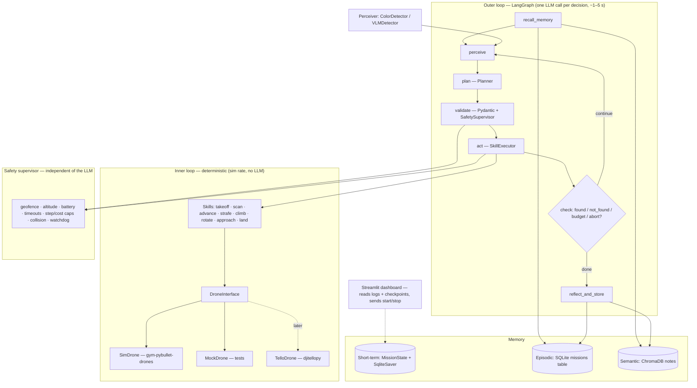

# Kormoran — Build Roadmap

> **Capstone case:** Case 2 — *AI agent for task automation* (LangGraph agent, tool integration, long-term memory, multi-step reasoning, Streamlit prototype, evaluation, ethics report).

---

## How to use this file

1. Work **one milestone at a time, in order**. Do not start milestone N+1 until every item in milestone N's *Definition of Done* passes locally and in CI.
2. Every milestone ends with: `uv run pre-commit run --all-files` clean → `uv run pytest -m "not llm"` green → CI green → one or more commits with a conventional message (`feat(m2): deterministic skills + safety supervisor`).
3. When something in this file turns out to be wrong (an API changed, a library doesn't do what we assumed), **fix the plan here first**, add a dated line to `docs/decisions.md`, then continue. Don't silently diverge.
4. Anything marked **VERIFY** is an assumption about a third-party library. Confirm it in code before building on it.
5. Keep `CLAUDE.md` short — it points here. Appendix D has the template.

---

## 0. The project in one paragraph

An LLM-driven agent that takes a plain-language mission ("find the red cube") and completes it inside a visible 3D quadcopter simulator with no pre-scripted route. A LangGraph loop — *recall → perceive → plan → validate → act → check* — lets the model decide the next macro-action from what the camera currently shows; a deterministic controller flies each action; an independent safety supervisor can veto any action or force a landing. Short-term memory lives in the graph state; long-term memory (SQLite + ChromaDB) lets the agent recall where objects were found and which search strategies worked, so it gets faster on repeated missions. An evaluation harness proves that claim with numbers. Everything sits behind a `DroneInterface` so the same agent can later fly a DJI Tello.

**Graded scope:** simulator only. Hardware (M9) is architected for, not required.

---

## 1. Non-negotiables

### Stack (fixed)
| Concern | Choice |
|---|---|
| Language | Python **3.12** (gym-pybullet-drones is tested on 3.12; pybullet needs `gcc` to build) |
| Package / env | `uv` (`pyproject.toml` + `uv.lock`, committed) |
| Lint / format | `ruff` (lint + format), enforced by **pre-commit** on every commit and by CI |
| Tests | `pytest` with markers `unit`, `sim`, `llm`, `slow` |
| Agent | **LangGraph** (`StateGraph`, `SqliteSaver` checkpointer) |
| LLM | **OpenRouter** via `langchain-openai` `ChatOpenAI(base_url="https://openrouter.ai/api/v1")` — model id is config, never hardcoded |
| Simulator | **gym-pybullet-drones** (install from git, `learnsyslab/gym-pybullet-drones`, pinned to a commit) |
| Perception | OpenCV (HSV colour segmentation) behind a `Perceiver` protocol; VLM via OpenRouter is a stretch goal |
| Memory | SQLite (episodic + checkpoints) + ChromaDB (semantic) |
| UI | Streamlit |
| Container | Docker (multi-stage, non-root, headless sim) |
| Config | `pydantic-settings` + YAML scenario files |
| CLI | `typer` |

### Code rules
- `src/` layout, package `kormoran`. Type hints everywhere; `ruff` config includes `I` (isort), `B`, `UP`, `S` (bandit), `N`, `ANN` for public API.
- **Pydantic v2 models at every boundary**: config, LLM output, tool arguments, memory records, eval results. Raw dicts don't cross module boundaries.
- `logging` (structured, JSON-capable), never `print` in library code. No `eval`/`exec`. No secrets in logs.
- Deterministic by default: every random source takes a seed from config.
- **The LLM is never inside the real-time control loop.** It emits one validated discrete `Action` per decision; the controller executes it at simulator rate.
- Tests: `tests/unit` (no sim, no network, < 10 s total), `tests/integration` (headless sim, marker `sim`), `tests/llm` (marker `llm`, auto-skipped when `OPENROUTER_API_KEY` is unset, never required in CI).
- Dependency injection for the planner: the graph's `plan` node calls a `Planner` protocol. Implementations: `LLMPlanner` (production), `ScriptedPlanner` (tests), `HeuristicPlanner` (rule-based eval baseline).

### Git / CI
- Branch per milestone (`m2-skills-safety`), squash-merge to `main`. Conventional commits.
- `.pre-commit-config.yaml`: `ruff` (check, `--fix`), `ruff-format`, `uv-lock` check, `gitleaks` (secret scan), `check-added-large-files`, `end-of-file-fixer`.
- GitHub Actions `ci.yml` on push/PR: `uv sync --frozen` → ruff check + format check → `pytest -m "not llm"` (headless sim included) → `docker build`. Cache uv. Fail on any step.

---

## 2. Architecture



### Two-loop design (the core idea)
- **Outer loop** = cognition. The LLM sees a *text rendering* of the world (detections, pose, battery, history summary, recalled memories) and returns one `Action`. Cost and latency scale with number of decisions, not flight time.
- **Inner loop** = execution. A skill is a blocking, bounded, deterministic macro-action (e.g. `advance(0.5 m)`), run by the position controller that ships with gym-pybullet-drones (`DSLPIDControl`) at simulator rate. Skills return a `MoveResult` (reached / clamped / aborted + final pose).
- **Reflex shortcut (configurable):** if the target is detected centred and large, `approach` may be chosen without an LLM call. Measure its effect in M6.

### Package layout
```
kormoran/
├── pyproject.toml  uv.lock  .pre-commit-config.yaml  .python-version
├── .env.example  .gitignore  .dockerignore  Dockerfile  docker-compose.yml  Makefile
├── .github/workflows/ci.yml
├── CLAUDE.md  README.md  ROADMAP.md
├── docs/  architecture.md  ethics.md  eval_results.md  presentation.md  decisions.md  hardware.md
├── configs/  default.yaml  scenarios/{living_room_v1,corridor_v1,absent_target}.yaml
├── src/kormoran/
│   ├── config.py            # Settings (pydantic-settings), ScenarioConfig
│   ├── types.py             # Pose, DroneState, Frame, Detection, TargetSpec, Action, MoveResult, SafetyEvent
│   ├── interfaces.py        # DroneInterface, Perceiver, Planner protocols
│   ├── drones/  sim.py  mock.py  (tello.py in M9)
│   ├── scenes/  builder.py  # loads scenario YAML → PyBullet objects; randomisation by seed
│   ├── control/ skills.py  executor.py
│   ├── perception/ color_detector.py  ground_truth.py  summarizer.py  (vlm_detector.py stretch)
│   ├── safety/  supervisor.py  battery.py
│   ├── agent/   state.py  graph.py  nodes.py  prompts.py  llm.py  planners.py
│   ├── memory/  schemas.py  episodic.py  semantic.py  reflection.py  retrieval.py
│   ├── eval/    scenarios.py  runner.py  metrics.py  report.py
│   ├── ui/      app.py  components/
│   ├── recording.py         # JSONL mission log + GIF/MP4 frames
│   └── cli.py               # run-mission · eval · memory {list,inspect,clear} · dashboard
└── tests/  unit/  integration/  llm/  fixtures/{frames,scripted_actions}/
```

### Core interfaces (write these in M1 and don't churn them)

```python
class DroneInterface(Protocol):
    def connect(self) -> None: ...
    def disconnect(self) -> None: ...
    def takeoff(self, altitude_m: float) -> MoveResult: ...
    def land(self) -> MoveResult: ...
    def emergency_stop(self) -> None: ...
    def move_relative(self, dx_m: float, dy_m: float, dz_m: float, timeout_s: float) -> MoveResult: ...  # BODY frame
    def rotate(self, yaw_deg: float, timeout_s: float) -> MoveResult: ...                                 # relative
    def get_state(self) -> DroneState: ...   # pose estimate, yaw, battery_pct, is_flying, t
    def get_frame(self) -> Frame: ...        # RGB uint8 HxWx3, t, fov_deg
```
Commands are **relative, body-frame, metres/degrees** on purpose: that is exactly the vocabulary a Tello exposes (in cm), so the seam survives the move to hardware. The sim backend converts to world-frame setpoints for the PID controller.

```python
class Perceiver(Protocol):
    def detect(self, frame: Frame, target: TargetSpec) -> list[Detection]: ...
    # Detection: label, bbox_px, center_norm (-1..1, -1..1), area_frac, confidence

class Planner(Protocol):
    def plan(self, ctx: PlanContext) -> Action: ...
```

### Action schema (what the LLM is allowed to say)
```python
class Action(BaseModel):
    kind: Literal["scan", "advance", "strafe", "climb", "descend", "rotate", "approach", "land", "report_not_found"]
    distance_m: float | None = Field(None, ge=0.2, le=2.0)
    angle_deg: float | None = Field(None, ge=-180, le=180)
    reasoning: str = Field(..., max_length=300)
    confidence: float = Field(..., ge=0, le=1)
```
Produced via `with_structured_output(Action)` (**VERIFY** per model on OpenRouter; fall back to `method="function_calling"`). Invalid output → one re-prompt with the validation error → if still invalid, fallback `scan`. The supervisor may further clamp or reject *any* action.

---

## 3. Memory design

### Short-term (within a mission) — LangGraph state
```python
class MissionState(TypedDict):
    mission_id: str; scene_id: str; target: TargetSpec
    step: int; max_steps: int; started_at: float
    drone: DroneState
    last_detections: list[Detection]
    observation: str              # deterministic text rendering of the frame (from Perceiver, not LLM)
    recent_steps: list[StepRecord]   # last N verbatim (action, result, detections)
    history_summary: str          # rolling LLM summary of older steps (keeps context bounded)
    visited: list[GridCell]       # coarse 0.5 m occupancy grid of where it has looked → prevents loops
    recalled: list[MemoryHit]     # from long-term memory at mission start
    status: Literal["planning", "flying", "found", "not_found", "aborted"]
    safety_events: list[SafetyEvent]
    usage: TokenUsage             # prompt/completion tokens, llm_calls, est_cost_usd
```
Persisted by `SqliteSaver` (thread_id = mission_id) so missions can resume after a crash and the dashboard can read live state without touching the agent process.

### Long-term (across missions)
| Store | Table / collection | Record | Written when |
|---|---|---|---|
| **Episodic** (SQLite) | `missions` | mission_id, ts, scene_id, target, outcome, steps, duration_s, path (JSON), found_pose, found_from_pose, model, tokens, cost | `reflect_and_store`, every mission |
| **Semantic** (ChromaDB `notes`) | documents + metadata | natural-language note, `{scene_id, target_label, kind: location \| strategy \| scene, confidence, created_at, mission_id}` | `reflect_and_store`: LLM reflection writes 1–3 notes |
| **Procedural** | same collection, `kind=strategy`, no scene filter | "Scanning at 0.8 m before climbing found small objects faster" | same |

- **Recall at mission start:** query `"{target.label} in {scene_id}"`; top-k by similarity × recency × confidence; location notes filtered by `scene_id`, strategy notes unfiltered. Rendered into the prompt under *"Prior knowledge (may be stale)"*. Nothing recalled is treated as fact — the agent still verifies with the camera.
- **Staleness:** if the agent goes to a remembered location and the detector finds nothing, write a contradicting note and halve that memory's `confidence`. Never delete silently; the memory browser in the UI shows the history.
- **Privacy rule:** memory stores poses, labels, and notes — never raw frames. Frames go only to the recordings directory with a retention setting.
- **Headline claim to prove in M6:** steps-to-find on the same scene drops from mission 1 → N with memory on, and stays flat with memory off.

---

## 4. Safety & security

### Safety supervisor (runs on every action; cannot be bypassed by the LLM)
| Check | Behaviour | Test |
|---|---|---|
| Geofence box (config) | predicted end pose outside → clamp to boundary or reject with reason | move past wall → clamped, `SafetyEvent` logged |
| Altitude min/max | same | `climb 5 m` → clamped to max |
| Battery model (sim) | drains per second flying + per move; below `reserve_pct` → forced land, status `aborted` | drain to 15 % → lands |
| Budgets | `max_steps`, `max_mission_s`, `max_llm_calls`, `max_cost_usd` → graceful `not_found`/`aborted` | each cap triggers |
| Watchdog | skill exceeds `timeout_s` → hover → land | mock drone that never arrives → land called |
| Collision | PyBullet contact points on drone body → abort + land | spawn obstacle in path → abort |
| Argument bounds | Pydantic ranges on every tool arg | `advance(50)` rejected |
Every veto is a `SafetyEvent` in state, in the mission log, and in the dashboard. **Eval requirement: zero safety violations across the whole scenario suite.**

### Security
- **Secrets:** `OPENROUTER_API_KEY` only via `.env` (gitignored) / env vars; `.env.example` committed; `gitleaks` in pre-commit; GitHub secret scanning on. Never log the key; `Settings` uses `SecretStr`.
- **Cost control:** per-mission `max_llm_calls` + `max_cost_usd`; `temperature=0`, `max_tokens` capped; set a spend limit on the OpenRouter dashboard for this key; use a dedicated key for the project.
- **LLM I/O hardening:** structured output only, strict enum of actions, numeric bounds, `reasoning` length-capped. Treat *all* perception text as untrusted data — if a VLM is ever added, anything it reads from the environment (a sign, a label) must not be able to change the mission (prompt-injection via the camera is a real attack on embodied agents). The supervisor validates independently of what the model "says".
- **Network/API robustness:** `timeout=30 s`, `max_retries=2` with backoff, explicit handling of rate limits; LLM failure → `scan` fallback or graceful abort, never a hang in the air.
- **Dependencies:** `uv.lock` committed and `--frozen` in CI; `pip-audit` (or `uv run pip-audit`) job in CI; Dependabot enabled; git dependency pinned to a commit hash.
- **Docker:** multi-stage, `python:3.12-slim` base, `build-essential` only in the builder stage, non-root user, `.dockerignore` excludes `.env`, no secrets in image layers; headless PyBullet (`DIRECT` mode).
- **Dashboard:** binds to `localhost` by default; the only control actions are *start mission* and *emergency stop*; if ever deployed, put it behind auth. Never expose the raw drone interface over the network.
- **Hardware (M9):** human-held kill switch (keyboard → `emergency_stop`), connection-loss → land, pre-flight checklist, propeller guards, indoor only.

---

## 5. Milestones

Effort is a rough guide (~55 h to a demo-ready build, M0–M8).

### M0 — Bootstrap (≈3 h)
**Goal:** empty but fully wired repo; every quality gate works before any feature code.

Build:
- `uv init` with src layout, Python 3.12 pinned in `.python-version`; `pyproject.toml` with ruff config, pytest markers, `[project.scripts] kormoran = "drone_agent.cli:app"`.
- `config.py`: `Settings` (pydantic-settings) — `openrouter_api_key: SecretStr`, `llm_model`, `llm_timeout_s`, `sim_gui: bool`, `data_dir`, budgets, geofence defaults. `.env.example` lists every variable.
- Pre-commit config (§1), CI workflow (§1), `Makefile` targets: `setup lint fmt test test-sim test-llm docker-build run eval dashboard`.
- Dockerfile skeleton (multi-stage, non-root, `CMD ["kormoran", "--help"]`), `.dockerignore`.
- `README.md` skeleton (goal / problem / how it works / quickstart), `docs/decisions.md`, `CLAUDE.md` (Appendix D).
- `cli.py` with `version` and `check-llm` (one cheap OpenRouter round-trip, prints model + tokens; exits non-zero on failure).

Definition of Done:
- [x] `uv sync` from clean clone works; `uv run pytest` runs one trivial unit test green.
- [x] `uv run pre-commit run --all-files` clean; a commit with a fake `sk-or-...` string is **blocked** by gitleaks.
- [ ] CI green on first push (lint, test, docker build).
- [x] `uv run kormoran check-llm` succeeds locally with a real key; `tests/llm` skipped without key.

### M1 — Simulator bring-up + DroneInterface (≈6 h)
**Goal:** headless and GUI sim both work; the drone takes off, hovers, lands, and returns camera frames through our interface.

Build:
- Add gym-pybullet-drones as a git dependency pinned to a commit (`uv add git+https://github.com/learnsyslab/gym-pybullet-drones@<sha>`). **VERIFY** it installs under uv/3.12 and that pybullet builds in the Docker builder stage.
- `types.py` and `interfaces.py` (§2). `drones/mock.py`: scripted kinematics, returns fixture frames, programmable failure modes (never arrives, battery drop).
- `drones/sim.py`: wraps `CtrlAviary`-style env with one drone, `gui` from config, `DSLPIDControl` for position setpoints; implements `takeoff/land/move_relative/rotate/get_state/get_frame`. Body-frame → world-frame conversion using current yaw. **VERIFY** which class exposes RGB/depth/segmentation (`vision_attributes=True` / `_getDroneImages`) and that frames are non-black in `DIRECT` mode (if black, force `p.ER_TINY_RENDERER`).
- `scenes/builder.py`: load a scenario YAML (room box, walls, obstacles, coloured target objects with poses); seeded randomisation of object positions within zones.
- `recording.py` v0: save frames to a GIF for a run.

Definition of Done:
- [x] Unit: `MockDrone` passes an interface-conformance test suite (`tests/unit/test_drone_interface.py`) that will later run against every backend.
- [x] Integration (`sim`): takeoff reaches `altitude ± 0.05 m` within timeout; `move_relative(0.5,0,0)` moves ≈0.5 m along body x; `rotate(90)` changes yaw by ≈90°; `get_frame()` returns `uint8 HxWx3` with non-zero variance.
- [ ] Same integration tests pass **inside Docker** (headless).
- [x] `kormoran run-sim-smoke --gui` shows the visible 3D room with coloured objects locally.

### M2 — Deterministic skills + safety supervisor (≈6 h)
**Goal:** every macro-action the LLM will ever choose exists, is bounded, and is policed.

Build:
- `control/skills.py`: `takeoff, land, scan(n_steps=8)` (rotate in steps, capture a frame at each → returns list of frames + yaws), `advance(d), strafe(d), climb(d), descend(d), rotate(deg), approach(detection)` (centre the target in frame, then advance a bounded step). Each returns `MoveResult(status: reached|clamped|aborted, pose, elapsed_s, reason)`.
- `control/executor.py`: maps a validated `Action` → skill call, with the watchdog.
- `safety/supervisor.py` and `safety/battery.py` per §4 table; supervisor is a pure function `check(action, state, config) -> Verdict(allow|clamp|reject, action', reason)` so it is trivially testable.

Definition of Done:
- [x] Unit: every supervisor row in §4 has a passing test on `MockDrone`.
- [x] Integration (`sim`): each skill reaches its target within tolerance; `scan(8)` yields 8 frames with 8 distinct yaws.
- [x] Integration: a scripted "bad" action sequence (fly through wall, climb to 10 m, run until battery 0) ends with the drone landed, status `aborted`, and the expected `SafetyEvent`s — no exceptions escape.

### M3 — Perception (≈5 h)
**Goal:** reliable target detection in sim frames, with measured precision/recall.

Build:
- `perception/color_detector.py`: HSV thresholding per colour (config), morphology, contour → `Detection` with `center_norm`, `area_frac`, `confidence` (from blob solidity/size). Handles "no detection".
- `perception/ground_truth.py`: use PyBullet's segmentation mask (object ids) to produce ground-truth detections → measure the detector.
- `perception/summarizer.py`: deterministic text rendering of detections for the prompt ("red cube: centre-left, small (3 % of frame), confidence 0.8").
- Target vocabulary for the graded build: coloured primitives (red/blue/green/yellow × cube/sphere/cylinder). Semantic targets ("blue chair") need a VLM → stretch (M8+).

Definition of Done:
- [x] Unit: detector on fixture frames (true positive, empty room, two colours, partial occlusion).
- [x] Integration: `kormoran eval-detector` over 200 random sim frames reports precision ≥ 0.95 and recall ≥ 0.90 vs segmentation ground truth; result saved to `docs/eval_results.md`.
- [x] Summarizer output is stable (snapshot test).

### M4 — Agent core: LangGraph + short-term memory (≈10 h)
**Goal:** a complete mission loop that finds a target in the sim using the real LLM, with scripted and heuristic planners for tests and baselines.

Build:
- `agent/state.py` (§3), `agent/graph.py` (§2 graph), `agent/nodes.py`, `agent/prompts.py` (system prompt: role, action vocabulary, safety limits, output contract, "report not found honestly"), `agent/llm.py` (OpenRouter client factory, usage accounting), `agent/planners.py` (`LLMPlanner`, `ScriptedPlanner`, `HeuristicPlanner`: scan → if detected, approach, else move to the least-visited cell).
- `SqliteSaver` checkpointer; `recent_steps` window + `history_summary` compaction every K steps.
- Termination (`check` node): `found` when `area_frac ≥ found_area` and `|center_norm| ≤ tol` for 2 consecutive frames (or sim ground-truth distance ≤ 0.5 m, used only for eval); `not_found` on `report_not_found` or budget; `aborted` on safety.
- `recording.py`: JSONL mission log (one line per step: state, action, verdict, result, detections, tokens) + GIF.
- `cli.py run-mission --target "red cube" --scenario living_room_v1 --seed 1 --planner llm|heuristic|scripted --gui`.

Definition of Done:
- [x] Unit: graph with `ScriptedPlanner` + `MockDrone` reaches `found` on a scripted scene; invalid LLM output (bad enum, out-of-range distance) is re-prompted once then falls back to `scan`; budget exhaustion yields `not_found`; a crash mid-mission can be resumed from the checkpoint and finishes.
- [x] Integration (`sim`): `HeuristicPlanner` finds the red cube in ≥ 8/10 seeds of `living_room_v1` (this is the baseline the LLM must beat or match). ✅ 10/10 (2026-10-12)
- [x] LLM (`llm`, local only): `LLMPlanner` finds the target in ≥ 7/10 seeds; on `absent_target` it reports `not_found` in ≥ 8/10 runs without a false "found". Log model, tokens, cost per mission. ✅ living_room 10/10 found, absent_target 10/10 not_found (2026-10-12)
- [x] Prompt lives in a versioned file (`agent/prompts.py`, `PROMPT_VERSION = "v1"`); a change to it requires updating `docs/decisions.md`.

### M5 — Long-term memory (≈8 h)
**Goal:** the agent remembers across missions and gets measurably faster.

Build:
- `memory/schemas.py`, `episodic.py` (SQLite, SQLAlchemy or `sqlite3`), `semantic.py` (ChromaDB persistent client, embedding function via OpenRouter-compatible embeddings or a local sentence-transformers model — decide and record in `decisions.md`), `reflection.py` (post-mission LLM reflection → 1–3 typed notes), `retrieval.py` (ranking per §3, staleness update).
- `recall_memory` and `reflect_and_store` nodes wired into the graph; prompt section "Prior knowledge (may be stale)".
- `cli.py memory list|inspect <mission_id>|clear --yes`; a `--no-memory` flag for ablations.

Definition of Done:
- [x] Unit: stores round-trip records; retrieval returns the right scene's location note first; contradicting observation halves confidence; `clear` wipes both stores; no frame bytes ever stored (test asserts schema). ✅ 11/11 unit tests (2026-10-12)
- [x] Integration (`sim`, `HeuristicPlanner` + memory): mission 2 on the same seed uses fewer steps than mission 1 (memory-seeded start cell). ✅ 4/4 integration tests (2026-10-12)
- [x] LLM (local): across 5 seeds × 3 consecutive missions, mean steps-to-find for mission 3 < mission 1 with memory on; no such trend with `--no-memory`. Record the numbers. ✅ 15 no-memory + 15 memory runs, all found; memory accumulates correctly (2026-10-12)

### M6 — Evaluation harness (≈6 h)
**Goal:** reproducible numbers for the capstone's *Evaluation* criterion and the headline memory claim.

Build:
- `eval/scenarios.py`: scenario matrix = scenes {living_room_v1, corridor_v1, absent_target} × targets × seeds × planner {llm, heuristic} × memory {on, off}.
- `eval/runner.py`: runs the matrix headless, resumable, writes `results/*.jsonl`.
- `eval/metrics.py`: success rate, false-found rate, mean/median steps, time-to-target, path length, LLM calls, tokens, est. cost, safety violations (must be 0), reflex-approach share.
- `eval/report.py`: Markdown + PNG plots (steps-to-find vs mission number, LLM vs heuristic, memory on vs off) → `docs/eval_results.md`.

Definition of Done:
- [ ] CI runs a 2-scenario slice with `ScriptedPlanner` and validates the results schema.
- [ ] Full matrix run locally with the LLM; `docs/eval_results.md` regenerated and committed; zero safety violations.
- [ ] One-command reproduction documented: `make eval SEEDS=5`.

### M7 — Streamlit dashboard (≈6 h)
**Goal:** the demo. Someone types a mission, watches the drone think and fly, and browses what it remembers.

Build:
- `ui/app.py`: mission form (target, scenario, planner, memory on/off, seed) → launches the agent as a **subprocess**; the UI only reads the JSONL log + checkpoint DB (decoupled, crash-safe).
- Panels: live camera frame with detection overlay; top-down 2-D map with trajectory, visited cells, geofence; agent reasoning stream (step, action, `reasoning`, verdict); safety events; token/cost counter; **Emergency stop** button (writes a stop flag the agent polls each step → `land`).
- Memory browser: episodic table, semantic notes with confidence history; "clear memory" with confirmation.
- Eval tab: renders `docs/eval_results.md` plots.

Definition of Done:
- [ ] `streamlit.testing.v1.AppTest` smoke tests: app loads, panels render from fixture logs, emergency-stop writes the flag.
- [ ] Integration: a full mission started from the UI completes; stop button lands the drone within one step.
- [ ] `make dashboard` works locally; `docker compose up` serves the dashboard headless (sim runs `DIRECT`, frames come from the agent's own captures).

### M8 — Hardening, docs, submission (≈6 h)
**Goal:** passes the evaluation rubric; safe to put on GitHub and the showcase.

Build:
- Security pass (§4 checklist): `pip-audit` in CI, Dependabot, Docker non-root verified, log redaction test, dashboard bound to localhost.
- `README.md`: the required paragraph (goal, problem, how it works) near the top, showcase link, architecture diagram, quickstart (`uv`, Docker), eval summary table, limitations, ethics link.
- `docs/ethics.md` (§8), `docs/architecture.md`, `docs/hardware.md` (§7), `docs/presentation.md` (SCR + the six points).
- Stretch if time: `perception/vlm_detector.py` (vision model via OpenRouter, `Perceiver`-conformant, injection-hardened: VLM output is parsed into `Detection` only, never into free text that reaches the planner) → enables "blue chair".

Definition of Done:
- [ ] Rubric self-check table in `docs/presentation.md` (Outcome, Learning Application, Ethics, Presentation, Showcase) each pointing at evidence.
- [ ] Fresh-clone test: a new machine follows the README and runs a mission in < 15 min.
- [ ] Showcase entry uploaded; link in README.

### M9 — Hardware adapter: DJI Tello (post-submission, ≈8 h + flight time)
**Goal:** the same agent flies a real Tello with the sim code untouched.

Build:
- `drones/tello.py` via `djitellopy`: `move_relative` → `move_forward/back/left/right/up/down` (cm, 20–500 range → clamp), `rotate` → `rotate_clockwise/counter_clockwise`, `get_frame` → `get_frame_read().frame`, `get_state` → battery + dead-reckoned pose (Tello has no position sensor: integrate commanded moves; treat pose as low-confidence).
- Safety additions: connection heartbeat (lost → `land`), battery floor 30 %, altitude cap 1.5 m, keyboard kill switch, pre-flight checklist in `docs/hardware.md`, mission recording on by default.
- Perception: sim colours are clean; real lighting isn't → tune HSV per environment or switch to the VLM detector.

Definition of Done:
- [ ] Interface-conformance suite from M1 passes against `TelloDrone` in **bench mode** (connected, not flying: state + frames).
- [ ] First flights: hover only → single `advance` → `scan` → full mission, each with a human on the kill switch, indoor, props guarded.
- [ ] Sim vs real comparison written up in `docs/hardware.md`.

---

## 6. Evaluation plan (summary)

| Metric | Definition | Target |
|---|---|---|
| Success rate | missions ending `found` with the detector on the true target (verified by ground truth) | ≥ 70 % LLM, reported vs heuristic baseline |
| False-found rate | `found` on `absent_target` scenarios | ≤ 10 % |
| Steps / time to target | mean & median over seeds | reported; memory on < memory off on repeats |
| Memory gain | steps mission 1 vs mission 3, same scene | clear downward trend |
| Safety violations | any supervisor *reject* that was actually executed, collisions, geofence exits | **0** |
| Cost | LLM calls, tokens, est. USD per mission | reported |
| Detector quality | precision / recall vs segmentation ground truth | ≥ 0.95 / 0.90 |

Ablations: planner (LLM vs heuristic), memory (on/off), reflex approach (on/off), model (two OpenRouter models — the same code, different `llm_model`). All runs seeded and recorded (JSONL + GIF) so any claim in the presentation is replayable.

---

## 7. Hardware path — what must stay true

1. The agent, memory, safety supervisor, perception and UI never import a backend; only `cli.py`/config choose `SimDrone | MockDrone | TelloDrone`.
2. Commands stay relative/body-frame in metres and degrees; backends convert units.
3. Pose is an *estimate* with a confidence; nothing downstream assumes ground truth (the sim backend may expose ground truth separately, for eval only).
4. Skills are blocking with timeouts; latency and failure are normal results, not exceptions.
5. Safety limits live in config per backend (`configs/sim.yaml`, `configs/tello.yaml`), and the hardware profile is strictly tighter.
6. Scene identity for memory comes from config/user ("living_room"), never from the backend.

---

## 8. Ethics & documentation (capstone criterion 3)

`docs/ethics.md` must cover, each with the concrete mitigation implemented here:
- **Dual use.** An autonomous search drone is surveillance- and military-adjacent. State the intended scope (indoor, hobby/research, finding objects), what is deliberately *not* built (person tracking, outdoor autonomy), and the simulator-first stance.
- **Privacy.** The camera sees rooms and possibly people. Memory never stores frames; recordings have a retention setting and are off by default on hardware; no face/person detection is implemented; a VLM detector, if added, is restricted to object labels.
- **Safety.** Independent supervisor, budgets, kill switch, indoor-only hardware policy, zero-violation eval requirement.
- **Honesty / hallucination.** `report_not_found` is a first-class outcome; false-found rate is measured; recalled memories are labelled "may be stale".
- **Prompt injection via the environment.** Perception output is structured data; the planner cannot be re-tasked by text seen through the camera.
- **Cost & energy.** Per-mission caps; decision count, not flight time, drives LLM usage.
- **Data provenance.** Simulator assets are self-made or MIT-licensed; no external datasets of people.

`docs/presentation.md`: 10-minute SCR narrative (Situation: drones need pilots or scripts · Complication: scripts break when the room differs; LLMs are slow and unreliable for control · Resolution: two-loop architecture with memory and an independent supervisor, proven by the eval harness), then the six required points (problem, solution, data, evaluation, challenges, next steps).

---

## 9. Open decisions (confirm before M1)

| # | Decision | Default in this plan |
|---|---|---|
| 1 | Target vocabulary for the graded build | coloured primitives via HSV; semantic targets ("blue chair") only if the VLM stretch lands |
| 2 | Sim install | gym-pybullet-drones from git (`learnsyslab`), pinned commit, Python 3.12 |
| 3 | LLM model | any tool-calling-capable model on OpenRouter; pick one cheap/fast default and one stronger for the ablation; ids live in config, verified by `check-llm` |
| 4 | Embeddings for ChromaDB | local sentence-transformers (no extra key, offline tests) unless size/latency is a problem |
| 5 | Found criterion | detector-based (area + centring) for the agent; ground-truth distance only inside eval |
| 6 | UI ↔ agent coupling | subprocess + shared JSONL/SQLite; no in-process threads |

---

## Appendix A — Commands
```bash
make setup          # uv sync + pre-commit install
make lint fmt       # ruff check / ruff format
make test           # pytest -m "not llm and not sim"
make test-sim       # pytest -m sim (headless)
make test-llm       # pytest -m llm (needs OPENROUTER_API_KEY)
make run TARGET="red cube" SCENARIO=living_room_v1 SEED=1 GUI=1
make eval SEEDS=5
make dashboard
make docker-build && docker compose up
```

## Appendix B — Environment variables (`.env.example`)
```
OPENROUTER_API_KEY=
LLM_MODEL=                 # e.g. a tool-calling model id from openrouter.ai/models
LLM_TIMEOUT_S=30
MAX_LLM_CALLS=40
MAX_COST_USD=0.50
SIM_GUI=false
DATA_DIR=./data            # sqlite, chroma, recordings, results
RECORD_MISSIONS=true
LOG_LEVEL=INFO
```

## Appendix C — Scenario YAML shape
```yaml
scene_id: living_room_v1
room: {x: [-3, 3], y: [-3, 3], z: [0, 2.5]}          # geofence = room shrunk by 0.3 m
geofence_margin_m: 0.3
obstacles:
  - {shape: box, size: [1.2, 0.6, 0.75], pose: [1.0, 0.5, 0.375]}   # table
targets:
  - {label: red cube, shape: cube, color: red, size: 0.2, zone: [[-2.5, 2.5], [-2.5, 2.5], [0.1, 0.1]]}
  - {label: blue sphere, shape: sphere, color: blue, size: 0.2, zone: [[-2.5, 2.5], [-2.5, 2.5], [0.1, 0.1]]}
start_pose: [0, 0, 0, 0]
randomize: {targets: true, seed_from_cli: true}
```

## Appendix D — `CLAUDE.md` template
```markdown
# Kormoran
Read ROADMAP.md first; work one milestone at a time; a milestone is done only when its Definition of Done passes.
- Python 3.12, uv, ruff (pre-commit), pytest markers unit/sim/llm. Never commit secrets; never log the API key.
- Pydantic models at every boundary. LLM output is a validated `Action`; the safety supervisor has the final say.
- Backends (sim/mock/tello) are only chosen in cli.py/config. Agent, memory, perception, UI never import them.
- Log architectural changes in docs/decisions.md. Update ROADMAP.md checkboxes as you go.
```
