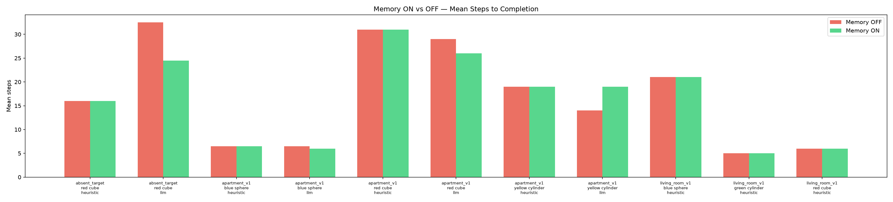
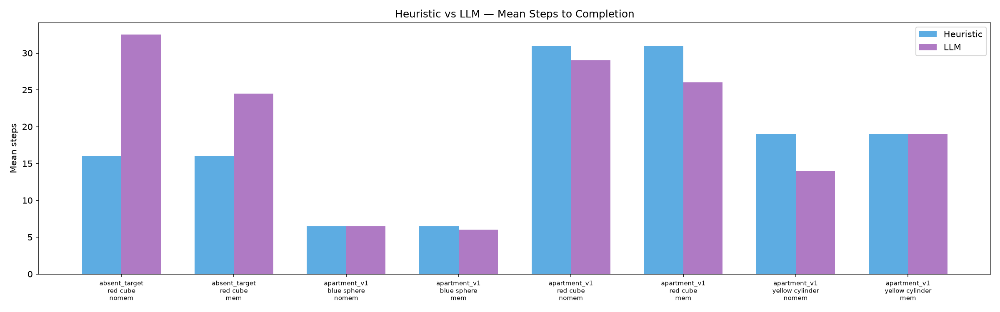
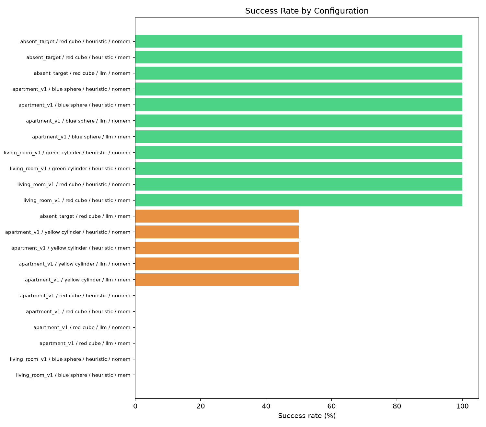

# Evaluation Results

**Total runs:** 38
**Total tokens:** 387,578
**Total cost:** $0.0640
**Safety violations:** 0

## Summary Table

| Scenario | Target | Planner | Memory | Runs | Success | False-found | Mean steps | Median steps | Mean path (m) | LLM calls | Tokens | Cost ($) | Safety |
|---|---|---|---|---|---|---|---|---|---|---|---|---|---|
| absent_target | red cube | heuristic | off | 2 | 100.0% | 0.0% | 16.0 | 16 | 4.04 | 0 | 0 | 0.0000 | 0 |
| absent_target | red cube | heuristic | on | 2 | 100.0% | 0.0% | 16.0 | 16 | 4.04 | 0 | 0 | 0.0000 | 0 |
| absent_target | red cube | llm | off | 2 | 100.0% | 0.0% | 32.5 | 32 | 8.82 | 20 | 39653 | 0.0065 | 0 |
| absent_target | red cube | llm | on | 2 | 50.0% | 0.0% | 24.5 | 24 | 9.58 | 29 | 59122 | 0.0098 | 0 |
| apartment_v1 | blue sphere | heuristic | off | 2 | 100.0% | 0.0% | 6.5 | 6 | 2.24 | 0 | 0 | 0.0000 | 0 |
| apartment_v1 | blue sphere | heuristic | on | 2 | 100.0% | 0.0% | 6.5 | 6 | 2.24 | 0 | 0 | 0.0000 | 0 |
| apartment_v1 | blue sphere | llm | off | 2 | 100.0% | 0.0% | 6.5 | 6 | 2.02 | 6 | 11580 | 0.0019 | 0 |
| apartment_v1 | blue sphere | llm | on | 2 | 100.0% | 0.0% | 6.0 | 6 | 2.00 | 5 | 10490 | 0.0017 | 0 |
| apartment_v1 | red cube | heuristic | off | 2 | 0.0% | 0.0% | 31.0 | 31 | 12.67 | 0 | 0 | 0.0000 | 0 |
| apartment_v1 | red cube | heuristic | on | 2 | 0.0% | 0.0% | 31.0 | 31 | 12.62 | 0 | 0 | 0.0000 | 0 |
| apartment_v1 | red cube | llm | off | 2 | 0.0% | 0.0% | 29.0 | 29 | 12.94 | 48 | 98486 | 0.0163 | 0 |
| apartment_v1 | red cube | llm | on | 2 | 0.0% | 0.0% | 26.0 | 26 | 10.43 | 41 | 91774 | 0.0151 | 0 |
| apartment_v1 | yellow cylinder | heuristic | off | 2 | 50.0% | 0.0% | 19.0 | 19 | 7.63 | 0 | 0 | 0.0000 | 0 |
| apartment_v1 | yellow cylinder | heuristic | on | 2 | 50.0% | 0.0% | 19.0 | 19 | 7.64 | 0 | 0 | 0.0000 | 0 |
| apartment_v1 | yellow cylinder | llm | off | 2 | 50.0% | 0.0% | 14.0 | 14 | 5.86 | 13 | 26861 | 0.0045 | 0 |
| apartment_v1 | yellow cylinder | llm | on | 2 | 50.0% | 0.0% | 19.0 | 19 | 8.61 | 22 | 49612 | 0.0083 | 0 |
| living_room_v1 | blue sphere | heuristic | off | 1 | 0.0% | 0.0% | 21.0 | 21 | 5.15 | 0 | 0 | 0.0000 | 0 |
| living_room_v1 | blue sphere | heuristic | on | 1 | 0.0% | 0.0% | 21.0 | 21 | 5.15 | 0 | 0 | 0.0000 | 0 |
| living_room_v1 | green cylinder | heuristic | off | 1 | 100.0% | 0.0% | 5.0 | 5 | 1.55 | 0 | 0 | 0.0000 | 0 |
| living_room_v1 | green cylinder | heuristic | on | 1 | 100.0% | 0.0% | 5.0 | 5 | 1.55 | 0 | 0 | 0.0000 | 0 |
| living_room_v1 | red cube | heuristic | off | 1 | 100.0% | 0.0% | 6.0 | 6 | 1.97 | 0 | 0 | 0.0000 | 0 |
| living_room_v1 | red cube | heuristic | on | 1 | 100.0% | 0.0% | 6.0 | 6 | 1.97 | 0 | 0 | 0.0000 | 0 |

## Plots

### Memory Comparison

### Planner Comparison

### Success Rates

## Per-Run Details

| Scenario | Target | Planner | Memory | Seed | Outcome | Steps | Path (m) | LLM calls | Cost ($) | Safety |
|---|---|---|---|---|---|---|---|---|---|---|
| absent_target | red cube | heuristic | off | 1 | not_found | 21 | 5.15 | 0 | 0.0000 | 0 |
| absent_target | red cube | heuristic | off | 2 | not_found | 11 | 2.94 | 0 | 0.0000 | 0 |
| absent_target | red cube | heuristic | on | 1 | not_found | 21 | 5.15 | 0 | 0.0000 | 0 |
| absent_target | red cube | heuristic | on | 2 | not_found | 11 | 2.94 | 0 | 0.0000 | 0 |
| absent_target | red cube | llm | off | 1 | not_found | 54 | 14.71 | 10 | 0.0032 | 0 |
| absent_target | red cube | llm | off | 2 | not_found | 11 | 2.93 | 10 | 0.0032 | 0 |
| absent_target | red cube | llm | on | 1 | error | 38 | 16.02 | 19 | 0.0065 | 0 |
| absent_target | red cube | llm | on | 2 | not_found | 11 | 3.13 | 10 | 0.0033 | 0 |
| apartment_v1 | blue sphere | heuristic | off | 1 | found | 5 | 1.53 | 0 | 0.0000 | 0 |
| apartment_v1 | blue sphere | heuristic | off | 2 | found | 8 | 2.95 | 0 | 0.0000 | 0 |
| apartment_v1 | blue sphere | heuristic | on | 1 | found | 5 | 1.53 | 0 | 0.0000 | 0 |
| apartment_v1 | blue sphere | heuristic | on | 2 | found | 8 | 2.95 | 0 | 0.0000 | 0 |
| apartment_v1 | blue sphere | llm | off | 1 | found | 5 | 1.53 | 1 | 0.0003 | 0 |
| apartment_v1 | blue sphere | llm | off | 2 | found | 8 | 2.51 | 5 | 0.0016 | 0 |
| apartment_v1 | blue sphere | llm | on | 1 | found | 5 | 1.53 | 1 | 0.0003 | 0 |
| apartment_v1 | blue sphere | llm | on | 2 | found | 7 | 2.46 | 4 | 0.0014 | 0 |
| apartment_v1 | red cube | heuristic | off | 1 | not_found | 31 | 12.62 | 0 | 0.0000 | 0 |
| apartment_v1 | red cube | heuristic | off | 2 | not_found | 31 | 12.71 | 0 | 0.0000 | 0 |
| apartment_v1 | red cube | heuristic | on | 1 | not_found | 31 | 12.62 | 0 | 0.0000 | 0 |
| apartment_v1 | red cube | heuristic | on | 2 | not_found | 31 | 12.62 | 0 | 0.0000 | 0 |
| apartment_v1 | red cube | llm | off | 1 | error | 27 | 13.02 | 24 | 0.0081 | 0 |
| apartment_v1 | red cube | llm | off | 2 | not_found | 31 | 12.87 | 24 | 0.0081 | 0 |
| apartment_v1 | red cube | llm | on | 1 | error | 23 | 8.26 | 15 | 0.0055 | 0 |
| apartment_v1 | red cube | llm | on | 2 | error | 29 | 12.60 | 26 | 0.0097 | 0 |
| apartment_v1 | yellow cylinder | heuristic | off | 1 | found | 7 | 2.66 | 0 | 0.0000 | 0 |
| apartment_v1 | yellow cylinder | heuristic | off | 2 | not_found | 31 | 12.61 | 0 | 0.0000 | 0 |
| apartment_v1 | yellow cylinder | heuristic | on | 1 | found | 7 | 2.66 | 0 | 0.0000 | 0 |
| apartment_v1 | yellow cylinder | heuristic | on | 2 | not_found | 31 | 12.62 | 0 | 0.0000 | 0 |
| apartment_v1 | yellow cylinder | llm | off | 1 | found | 7 | 2.66 | 0 | 0.0000 | 0 |
| apartment_v1 | yellow cylinder | llm | off | 2 | error | 21 | 9.06 | 13 | 0.0045 | 0 |
| apartment_v1 | yellow cylinder | llm | on | 1 | found | 7 | 2.66 | 0 | 0.0000 | 0 |
| apartment_v1 | yellow cylinder | llm | on | 2 | not_found | 31 | 14.55 | 22 | 0.0083 | 0 |
| living_room_v1 | blue sphere | heuristic | off | 1 | not_found | 21 | 5.15 | 0 | 0.0000 | 0 |
| living_room_v1 | blue sphere | heuristic | on | 1 | not_found | 21 | 5.15 | 0 | 0.0000 | 0 |
| living_room_v1 | green cylinder | heuristic | off | 1 | found | 5 | 1.55 | 0 | 0.0000 | 0 |
| living_room_v1 | green cylinder | heuristic | on | 1 | found | 5 | 1.55 | 0 | 0.0000 | 0 |
| living_room_v1 | red cube | heuristic | off | 1 | found | 6 | 1.97 | 0 | 0.0000 | 0 |
| living_room_v1 | red cube | heuristic | on | 1 | found | 6 | 1.97 | 0 | 0.0000 | 0 |
